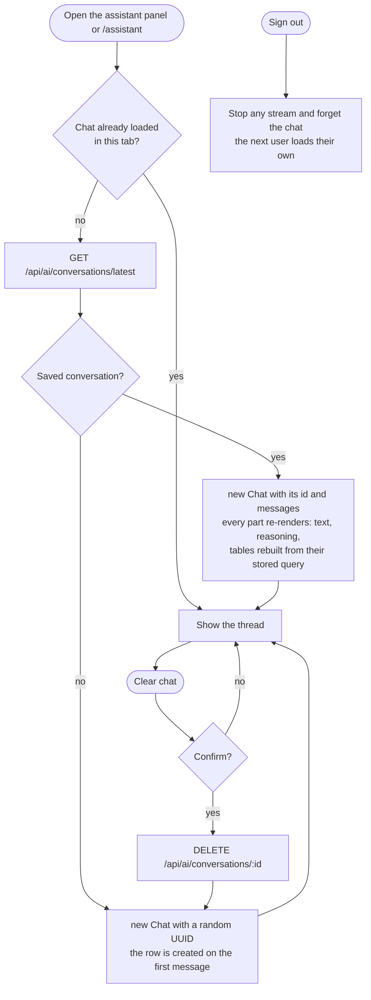
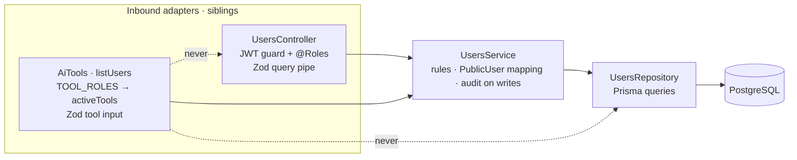
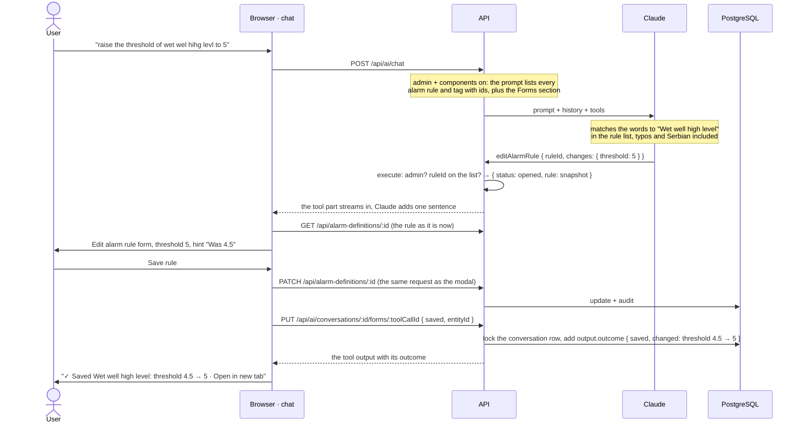

# AI assistant — end-to-end flow

How one chat message becomes a rendered answer, how a conversation is saved and restored, and which layer calls which.

## The tools

| Tool | Roles (`TOOL_ROLES`) | `execute` calls | Renders in the chat | "Open in new tab" |
|---|---|---|---|---|
| `listAlarms` | ADMIN, USER | `AlarmsService.list` | `AlarmsTable` · a click opens `AlarmDetailSheet` (acknowledge, clear, chart, timeline) | `/alarms` |
| `listAlarmRules` | ADMIN, USER | `AlarmDefinitionsService.list` | `DefinitionsTable` · admins: edit, delete, enable/disable | `/alarm-rules` |
| `listLogbookEntries` | ADMIN, USER | `LogbookService.list` | `LogbookTable` · authors edit, authors and admins delete | `/logbook` |
| `listDevices` | ADMIN, USER | `DevicesService.list` | `DevicesTable` · admins: edit, delete | `/devices` |
| `listTags` | ADMIN, USER | `TagsService.list` | `TagsTable` · chart; admins: add rule, edit, delete | `/tags` |
| `listAssets` | ADMIN, USER | `AssetsService.list` (open alarms from the prompt's asset tree) | `AssetsTable` · a click opens the asset's page; admins: edit, delete | `/assets` |
| `listUsers` | ADMIN, USER | `UsersService.list` | `UsersTable` · admins: make admin, deactivate, reactivate | `/users` |
| `listAuditLogs` | ADMIN (checked again in `execute`) | `AuditService.list` | `AuditTable` · read-only | `/audit` |
| `createUser` | ADMIN (checked again in `execute`) | nothing: opens the form | the Add user form (`CreateUserForm`), inside the answer | `/users`, once saved |
| `createAlarmRule` | ADMIN (checked again in `execute`) | checks `tagId` against the prompt's tag list | the New alarm rule form (`DefinitionForm`), inside the answer | `/alarm-rules`, once saved |
| `editAlarmRule` | ADMIN (checked again in `execute`) | checks `ruleId` against the prompt's rule list; `AlarmDefinitionsService.get` for Claude's copy | the Edit alarm rule form, loaded with the rule as it is now | `/alarm-rules`, once saved |

The list tools all work the same way, so the diagrams below follow `listUsers`. Swap in another list tool and the flow is identical. The three form tools open a form instead of a table and never write anything themselves; they have [their own section](#4-forms-in-the-chat-open-save-record).

Example request: *"Get me all admins, and also users named John."*

## 1. One message: request → tools → database → stream → render

```mermaid
flowchart TD
  subgraph FE1["1 · Frontend: send"]
    U(["User: 'Get me all admins, and also users named John'"])
    TH["ChatThread · sendMessage(text)"]
    PREF{{"Settings · assistant-preferences<br/>model · effort · 'Generate UI components'"}}
    CTX["browserTimeZone<br/>the browser's IANA time zone"]
    TR["chat-store transport<br/>body: id, trigger, the new message only,<br/>timeZone, generateUi, model, effort"]
    AF["authFetch<br/>Bearer access token · refresh + retry once on 401"]
    U --> TH --> TR
    PREF --> TR
    CTX --> TR
    TR --> AF
  end

  AF -- "POST /api/ai/chat" --> GUARD

  subgraph BE1["2 · Backend: prepare"]
    GUARD["JwtAuthGuard · any signed-in role"]
    CTRL["AiController.chat<br/>ChatRequestSchema validates the body<br/>AbortController tied to response close"]
    KEY{"ANTHROPIC_API_KEY set?"}
    E503["503 · AI is not configured"]
    HIST["ConversationsService.messages(id, user)<br/>another user's id → 404"]
    MERGE["submit: append the message<br/>regenerate: drop a trailing answer<br/>max 200 messages"]
    VAL["safeValidateUIMessages against the tool schemas<br/>last message must be the user's"]
    SAVE1["save the conversation<br/>the question survives a failed model call"]
    PROMPT["buildInstructions<br/>generic rules + app map + guardrails (English/Serbian only, off-topic)<br/>+ components or text-only section<br/>+ every asset and active person with ids (the dropdowns' choices)<br/>+ for admins with components on: the forms section, every alarm rule and tag with ids<br/>+ for admins with components off: the forms by title, and the switch that opens them<br/>+ for other roles: the forms they can't open, and which role can<br/>+ session: user, role, now in their time zone with its UTC offset"]
    ROLES["AiTools.activeFor(user, generateUi)<br/>TOOL_ROLES · the chat's @Roles<br/>form tools only with components on"]
    CALL["streamText<br/>chosen model · effort + adaptive thinking (not Haiku)<br/>instructions · history · tools<br/>activeTools · stopWhen AI_MAX_STEPS · abortSignal"]
    GUARD --> CTRL --> KEY
    KEY -- no --> E503
    KEY -- yes --> HIST --> MERGE --> VAL --> SAVE1
    SAVE1 --> PROMPT --> CALL
    SAVE1 --> ROLES --> CALL
  end

  CDB[("PostgreSQL · conversations<br/>messages as jsonb")]
  CDB -.->|stored messages| HIST
  SAVE1 --> CDB

  CALL -- "request" --> LLM

  subgraph AI["3 · Vercel AI SDK and Claude"]
    LLM{"Claude decides"}
    OFF["Unrelated to the app, or not English/Serbian<br/>a short polite refusal, no tool call"]
    CALLS["Parallel tool calls in one step<br/>listUsers title 'Admins', role ADMIN<br/>listUsers title 'Users named John', search 'John'"]
    FINAL["Final text<br/>components on: one short sentence<br/>components off: Markdown table"]
    LLM -- "off-topic or other language" --> OFF
    LLM -- "needs data" --> CALLS
    LLM -- "has tool results" --> FINAL
  end

  CALLS -- "SDK runs each execute" --> EXEC

  subgraph BE2["4 · Backend: tool execution, once per call"]
    EXEC["AiTools · listUsers.execute<br/>ListUsersQuerySchema.parse(filters, user's time zone, pageSize 20)"]
    SVC["UsersService.list"]
    REPO["UsersRepository.list · Prisma"]
    DB[("PostgreSQL · users")]
    RES["Tool result<br/>total + up to 20 rows: name, email, role, status"]
    EXEC --> SVC --> REPO --> DB
    DB --> RES
  end

  RES -- "next step: results go back to Claude" --> LLM

  subgraph BE3["5 · Backend: stream and save"]
    UIS["toUIMessageStream<br/>message ids · metadata: model, effort, createdAt, generateUi, finishReason"]
    SSE["pipeUIMessageStreamToResponse<br/>Server-Sent Events"]
    ONEND["onEnd: save the full conversation<br/>also after Stop"]
    UIS --> SSE
    UIS --> ONEND
  end

  ONEND --> CDB
  OFF --> UIS
  CALLS -- "tool input streams as it is generated" --> UIS
  RES --> UIS
  FINAL --> UIS

  SSE -- "text/event-stream" --> CHAT

  subgraph FE2["6 · Frontend: render the parts"]
    CHAT["useChat · message.parts"]
    KIND{"part type"}
    MD["text → Markdown"]
    RSN["reasoning → collapsed Reasoning"]
    MODE{"message.metadata.generateUi"}
    SKEL["input-streaming → skeleton"]
    VIEW["input complete → card titled 'Admins'<br/>UsersTable built from the tool input<br/>every column · row actions for admins<br/>Open in new tab ↗ /users?role=ADMIN"]
    ERR["output-error → alert"]
    LINE["components off → one muted line<br/>'Admins · 2 found · Open in new tab ↗'"]
    CHAT --> KIND
    KIND -- text --> MD
    KIND -- reasoning --> RSN
    KIND -- "tool-listUsers" --> MODE
    MODE -- on --> SKEL --> VIEW
    MODE -- on --> ERR
    MODE -- off --> LINE
  end

  VIEW -- "live fetch, same as the Users page<br/>GET /api/users?role=ADMIN · pageSize 5" --> UCTRL
  UCTRL["UsersController.list<br/>@Roles ADMIN, USER"] --> SVC
```

**Reading it:**
- **Only the `3 · Claude` box is AI-driven.** Everything else is ordinary, deterministic code; see [Who decides what](#who-decides-what).
- **Two data paths reach `UsersService`.** The tool's `execute` gives Claude up to 20 rows to reason over. The table in the chat fetches its own data through the REST API, exactly like the Users page, so it pages, sorts and authorizes the same way.
- **The tool input is a page query.** Apart from `title`, every field of `listUsers` (`search`, `role`, `status`, `lastSignIn`) is also a `/users` URL parameter. That is why "Open in new tab" can reproduce the table as a full page.
- **Dates are the user's.** The request carries the browser's time zone. The prompt's session block states the current date, time and UTC offset there, so Claude can turn "signed in yesterday" into `lastSignIn: 2026-09-28`, and the tool, the chat table and the Users page all read that date as the same local day. The alarm, logbook and audit tools take a window instead: "alarms raised yesterday" becomes `from: 2026-09-28T00:00:00+02:00, to: 2026-09-29T00:00:00+02:00`.
- **Ids from the dropdowns' own lists.** Where a page filters with a dropdown or the asset tree (`assetId` on alarms, alarm rules, logbook, devices and tags; `ancestorId` and `parentId` on assets; `authorId` on the logbook; `actorId` on the audit log), the tool takes the same ids. Every request's prompt lists the choices those dropdowns offer (`AiTools.filterOptions()`: `AssetsService.tree()` and `UsersService.options()`), each with its id. Claude matches "hilcrest" to Hillcrest Reservoir and writes its id, so the chat table, "Open in new tab" and the page's dropdown all show that asset. If a name fits several entries, Claude asks which one. A tool rejects an id that isn't on the lists, and Claude tries again.
- **Parallel calls.** Claude can emit several tool calls in one step; each renders as its own titled table, in order.
- **Actions work in the chat.** The chat table has the page's row actions for the user's role; a click on an alarm opens the same sheet as on the Alarms page. A change refreshes every table of that kind on screen; the rows Claude read earlier stay as they were in the conversation.

## Who decides what

| Step | Decided by | Where |
|---|---|---|
| Which model and effort answer | the user (pickers) | `assistant-preferences.ts` → request body |
| Which tools may be offered | code: role map (the audit and form tools are admin-only; form tools need components on) | `TOOL_ROLES`, `activeFor` in `ai.tools.ts` |
| Answer, refuse (off topic or not English/Serbian) or look something up | **Claude** | steered by `system-prompt.ts` |
| Which tool, with which filters, how many in parallel | **Claude** | steered by the tool descriptions in `assistant.ts` |
| Validating the tool input and running the query | code | AI SDK + `ListUsersQuerySchema` → `UsersService` |
| The wording of the answer | **Claude** | from the tool results |
| Which component draws a tool call, and its data | code | `tool-parts.tsx` registry; the table fetches via the REST API |
| Row actions in that component | code: the user's role | the `use…Actions` hooks in `users-table.tsx`, `definitions-table.tsx`, `devices-table.tsx`, `tags-table.tsx`, `assets-table.tsx`, `logbook-table.tsx`; the alarm sheet in `tool-parts.tsx` |
| Saving and restoring the conversation | code | `conversations.service.ts`, `chat-store.ts` |
| Which form to open, pre-filled with what, on which rule or tag | **Claude** | steered by the form tools' descriptions; ids from `<alarm-rules>` and `<tags>` |
| Saving the form | **the user**, through the page's REST endpoint | `useCreateUser`, `useSaveAlarmDefinition` |
| Recording what the user did with a form | code | `ai-forms.service.ts`, `form-parts.tsx` |

## 2. Conversation lifecycle: open, restore, clear, sign out

**Why components come back by themselves:** a message is saved with its `parts`: text, reasoning, and each tool call with its input and output. The chat renders purely from parts, so a restored conversation looks as it did. Tables rebuild from their stored *query*, so they show current data, while the text above them says what was true then.

**Why the server owns the history:** the client sends only its new message. The conversation follows the user to any browser, requests stay small, and a client can't rewrite past tool results that Claude will read. The cost: every turn sends the whole saved conversation to Claude, so clearing a long chat also makes the next answers cheaper.

## 3. Layering: who calls whom

A tool is an inbound adapter, like a controller: both translate an outside request into a call on the service layer, where the business rules live. Nest's guards and pipes don't run for tool calls, so the tool layer brings its own role map (`TOOL_ROLES`) and validation (the Zod tool input, then the same `ListUsersQuerySchema` the HTTP endpoint uses). The other tools pair up the same way, each with the controller of its page: `listAlarms` and `AlarmsController` both call `AlarmsService` through `ListAlarmsQuerySchema`, `listAuditLogs` and `AuditController` both call `AuditService` through `ListAuditLogsQuerySchema`, and so on for alarm rules, the logbook, devices, tags and assets.

## 4. Forms in the chat: open, save, record

*"Create a user named Milan Milanović"*, or *"raise the threshold of wet wel hihg levl to 5"*: the answer holds the app's own form, the one its page shows in a modal, drawn in place by `InlineDialog`. It has the same header, fields, button and top-right X, pre-filled with what Claude understood. The form tools never write anything. The user checks the form and saves it through the same REST endpoint the modal uses.

**Names are Claude's job, ids are the tool's input.** As with assets and people, every request from an admin with components on lists every alarm rule (`<alarm-rules>`, `AlarmDefinitionsService.options()`) and every tag (`<tags>`, `TagsService.options()`) with its id. Claude matches the user's words to an entry, typos, partial names and Serbian included, and writes the id. If the words fit several rules equally well ("the wet well level rule"), it asks which one before calling a tool; if nothing fits, it says so. No code matches names. `execute` rejects an id that isn't on the lists, and Claude tries again. Users, and everyone with components off, get none of this: the form tools aren't offered and the lists aren't sent.

**With components off.** A text-only answer has nowhere to show a form, so the form tools aren't offered. An admin's prompt still names the forms, by their titles (`FORM_TITLES` in `assistant.ts`), so a request for one ("add rule with condition not equal to") gets one or two sentences: turn on the **Generate UI components** switch and ask again, or use the page. Claude doesn't ask for the values, since it has nothing to put them in. Once the switch is on, the earlier request is still in the conversation, so "ask again" can be as short as "now".

**For a role without forms.** A user's prompt lists the forms their role can't open, with the role that can (`AiTools.formsFor`, from `TOOL_ROLES`). Asked to "create a new user", Claude says only admins can, instead of sending them to a page that hides the button from them.

**States of a form part** (`frontend/src/features/assistant/form-parts.tsx`):

| Part | Renders |
|---|---|
| `input-streaming`, `input-available` | skeleton, "Opening the … form" |
| `output-error` (e.g. an id not on the lists, which Claude then corrects) | alert |
| `output-available`, no `outcome` | the form in `InlineDialog`. The edit form loads the rule through `GET /alarm-definitions/:id` and puts Claude's `changes` over it, each changed field hinting what it was. The button stays off while the answer that opened it is still streaming. |
| `output-available` with `outcome` | one line: "✓ Added Milan Milanović" with Open in new tab, or "closed without saving" |

**Recording the outcome.** The tool call ended when the form opened, and the save is an ordinary REST request the AI side never sees. So after a save, or the X, the browser calls `PUT /api/ai/conversations/:id/forms/:toolCallId` with `{ status: 'saved', entityId }` or `{ status: 'closed' }`. `AiFormsService.recordOutcome` writes `outcome` into that tool call's output in the saved conversation:
- **Once, for an open form, in your own conversation, for your role.** Otherwise 409, 404 or 403.
- **The facts come from the database.** The browser sends only an id. The server reads the user or rule and writes the names itself, and for an edit what changed against the snapshot taken when the form opened (`diff`). Claude never reads browser-written text as fact.
- **No lost writes.** The conversation is one JSONB value, and the chat saves all of it when an answer ends. Both writers lock the row, and a save keeps any outcome already recorded (`keepOutcomes`), so an answer that ends after the user saved a form can't undo the outcome.

The result: a reload shows the outcome line instead of the form (no duplicate "Add user"), Claude reads on its next turn that Milan was added, and none of it costs a model call. A rule saved through a form is in the next request's `<alarm-rules>`, so "now edit it" works straight away.

## Adding the next domain

1. **Contract:** add the tool's schema to `genUiToolSchemas` in `packages/shared/src/assistant.ts`, with a `description` and a `.describe()` on every field. That text is how Claude learns the tool.
2. **Tool:** add it in `backend/src/features/ai/ai.tools.ts`, calling that domain's service, plus one `TOOL_ROLES` line. Export the service from the domain's module and import that module in `ai.module.ts`.
3. **Renderer:** add an entry in `frontend/src/features/assistant/tool-parts.tsx` that wraps the domain's existing table and links to its page. Keep role-based row actions inside the table itself, so the chat gets the same ones as the page. A filter the page sets with the asset or people dropdown takes the same id in the tool; Claude picks it from the lists in its prompt.

The system prompt doesn't change. TypeScript fails the build if the backend tools and the shared contract drift apart, or if a tool has no renderer.

**Adding a form tool** (create or edit something):
1. **Contract:** input and output schemas in `assistant.ts` (the input is the form's pre-fill; an edit takes the record's id from a prompt list), the output with `status: 'opened'` and an optional `outcome`, the name in `FORM_TOOL_NAMES`, and the dialog's title in `FORM_TITLES` (the chat labels the form with it, and a text-only answer names it).
2. **Tool:** `execute` checks the role and the ids and returns `opened`; it never writes. Add a `TOOL_ROLES` line, and an entry in `AiFormsService`'s `saved` map that reads the saved record. If Claude must pick a record by name, give it a pick list: an `options()` method on the service, a block in `pickLists()`, and an `idChecks` entry. Don't match names in code.
3. **Form:** split the page's dialog into the dialog and a form component that sits inside it (`CreateUserForm`, `DefinitionForm`), so the modal is unchanged, then add a `FORM_RENDERERS` entry in `form-parts.tsx` that renders that form.

## Where the code lives

| Step | File |
|---|---|
| Model, effort, components toggle, panel open state (per tab) | `frontend/src/features/assistant/assistant-preferences.ts` |
| Load, send, clear, auth | `frontend/src/features/assistant/chat-store.ts` |
| Thread, model/effort pickers, toolbar, composer | `frontend/src/features/assistant/chat-thread.tsx` |
| Render parts, Markdown | `frontend/src/features/assistant/chat-message.tsx` |
| Tool → component registry | `frontend/src/features/assistant/tool-parts.tsx` |
| Form tools: the form in the answer, its states, recording the outcome | `frontend/src/features/assistant/form-parts.tsx`, `frontend/src/components/inline-dialog.tsx` |
| The forms (page modal and chat) | `frontend/src/features/users/user-form-dialog.tsx`, `frontend/src/features/alarms/definition-form-dialog.tsx` |
| "Open in new tab" link | `frontend/src/components/view-card.tsx` |
| The tables (page and chat) | `frontend/src/features/`: `alarms/alarms-table.tsx`, `alarms/definitions-table.tsx`, `logbook/logbook-table.tsx`, `devices/devices-table.tsx`, `tags/tags-table.tsx`, `assets/assets-table.tsx`, `users/users-table.tsx`, `logbook/audit-table.tsx` |
| Asset, people, alarm rule and tag lists, id check | `backend/src/features/ai/ai.tools.ts` (`filterOptions`, `idChecks`); listed by `system-prompt.ts` |
| Recording a form's outcome | `backend/src/features/ai/ai-forms.service.ts`; `keepOutcomes` in `conversations.service.ts` |
| Contract: models, request, tools, messages | `packages/shared/src/assistant.ts` |
| Endpoints | `backend/src/features/ai/ai.controller.ts` |
| Model call, stream, save | `backend/src/features/ai/ai.service.ts` |
| Saved conversations | `backend/src/features/ai/conversations.service.ts` |
| Tools and role map | `backend/src/features/ai/ai.tools.ts` |
| System prompt and guardrail | `backend/src/features/ai/system-prompt.ts` |
