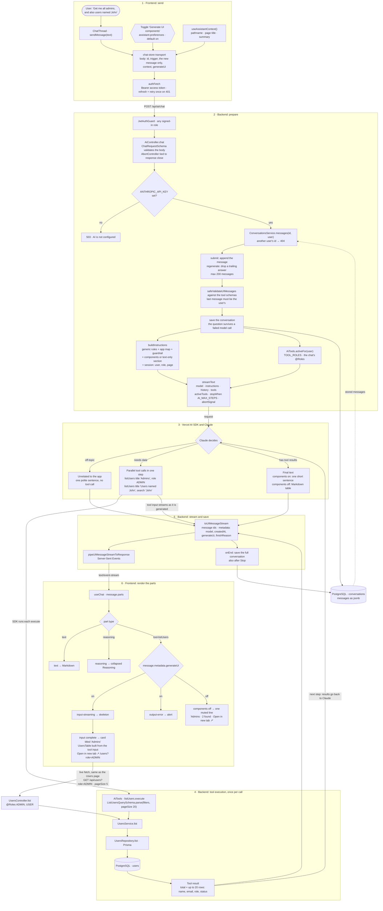
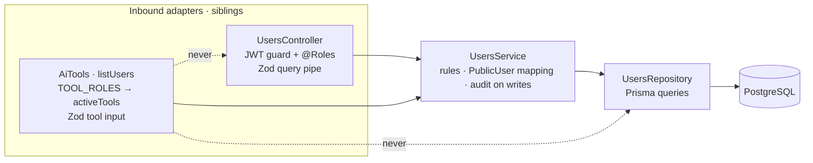

# AI assistant — end-to-end flow

How one chat message becomes a rendered answer, how a conversation is saved and restored, and which layer calls which.

Example request: *"Get me all admins, and also users named John."*

## 1. One message: request → tools → database → stream → render

**Reading it:**
- **Two data paths reach `UsersService`.** The tool's `execute` gives Claude up to 20 rows to reason over. The table in the chat fetches its own data through the REST API, exactly like the Users page, so it pages, sorts and authorizes the same way.
- **The tool input is a page query.** Apart from `title`, every field of `listUsers` is also a `/users` URL parameter. That is why "Open in new tab" can reproduce the table as a full page.
- **Parallel calls.** Claude can emit several tool calls in one step; each renders as its own titled table, in order.

## 2. Conversation lifecycle: open, restore, clear, sign out

**Why components come back by themselves:** a message is saved with its `parts`: text, reasoning, and each tool call with its input and output. The chat renders purely from parts, so a restored conversation looks as it did. Tables rebuild from their stored *query*, so they show current data, while the text above them says what was true then.

**Why the server owns the history:** the client sends only its new message. The conversation follows the user to any browser, requests stay small, and a client can't rewrite past tool results that Claude will read. The cost: every turn sends the whole saved conversation to Claude, so clearing a long chat also makes the next answers cheaper.

## 3. Layering: who calls whom

A tool is an inbound adapter, like a controller: both translate an outside request into a call on the service layer, where the business rules live. Nest's guards and pipes don't run for tool calls, so the tool layer brings its own role map (`TOOL_ROLES`) and validation (the Zod tool input, then the same `ListUsersQuerySchema` the HTTP endpoint uses).

## Adding the next domain

1. **Contract:** add the tool's schema to `genUiToolSchemas` in `packages/shared/src/assistant.ts`, with a `description` and a `.describe()` on every field. That text is how Claude learns the tool.
2. **Tool:** add it in `backend/src/features/ai/ai.tools.ts`, calling that domain's service, plus one `TOOL_ROLES` line. Import the domain's module in `ai.module.ts`.
3. **Renderer:** add an entry in `frontend/src/features/assistant/tool-parts.tsx` that wraps the domain's existing table and links to its page.

The system prompt doesn't change. TypeScript fails the build if the backend tools and the shared contract drift apart, or if a tool has no renderer.

## Where the code lives

| Step | File |
|---|---|
| Toggle, panel open state | `frontend/src/features/assistant/assistant-preferences.ts` |
| Load, send, clear, auth | `frontend/src/features/assistant/chat-store.ts` |
| Thread, toolbar, composer | `frontend/src/features/assistant/chat-thread.tsx` |
| Render parts, Markdown | `frontend/src/features/assistant/chat-message.tsx` |
| Tool → component registry | `frontend/src/features/assistant/tool-parts.tsx` |
| "Open in new tab" link | `frontend/src/components/view-card.tsx` |
| The users table (page and chat) | `frontend/src/features/users/users-table.tsx` |
| Contract: request, tools, messages | `packages/shared/src/assistant.ts` |
| Endpoints | `backend/src/features/ai/ai.controller.ts` |
| Model call, stream, save | `backend/src/features/ai/ai.service.ts` |
| Saved conversations | `backend/src/features/ai/conversations.service.ts` |
| Tools and role map | `backend/src/features/ai/ai.tools.ts` |
| System prompt and guardrail | `backend/src/features/ai/system-prompt.ts` |
